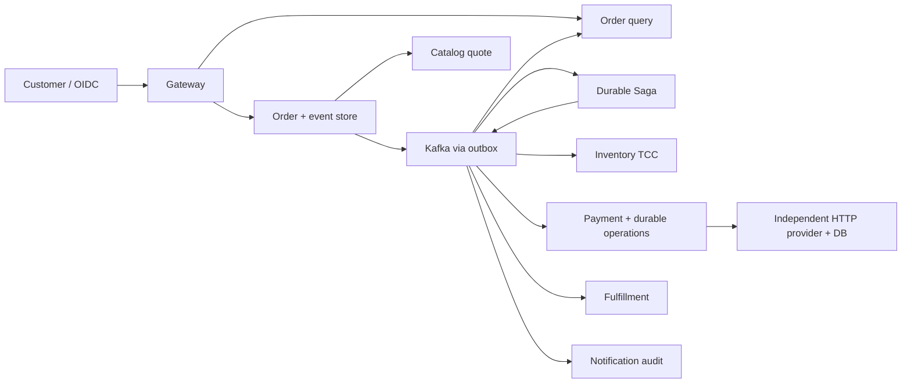

# Architecture

Order owns immutable facts; Saga owns technical coordination. Only OrderCreated, OrderConfirmed and OrderCancelled are
authoritative order facts in this baseline. Inventory/payment commands and responses are not appended blindly into Order
history.

Every service has separate DB credentials; no cross-service SQL or foreign keys. Queries can join tables only inside
their own read database. Kubernetes DNS replaces service discovery. Kafka command topics are per participant, and
integration order facts use a separate topic. Aggregate ID keys preserve per-partition broker order; duplicate relay
workers and retries still require state/version checks.

Synchronous JWT-protected HTTP handles customer commands, immediate quotes and reads. Durable asynchronous Kafka
commands handle long-running checkout. The quote is the only immediate dependency in checkout, with connect/read
timeouts. The accepted price is frozen in OrderCreated; client-supplied totals are ignored.

Gateway is a bounded JDK HTTP proxy rather than Spring Cloud Gateway to avoid another platform BOM in this small
baseline. Rate limiting is local to a replica. Payment/provider HTTP calls use bounded timeouts outside database
transactions, with durable status reconciliation. No Redis dependency is introduced. This is insufficient for strict
distributed quotas; see known limitations.

## Pattern decisions

| Pattern            | Boundary and guarantee                                                                      | Cost / avoid when                                                                                            |
|--------------------|---------------------------------------------------------------------------------------------|--------------------------------------------------------------------------------------------------------------|
| Saga orchestration | Local DB step + command outbox atomically; eventual participant completion or manual review | More durable workflow state and operational intervention; avoid for single-DB work                           |
| Choreography       | Participants react to facts; no central cursor                                              | Harder global visibility/retries/compensation ownership; use for independent reactions, as Notification does |
| TCC                | Inventory provisionally owns stock until confirm/cancel/expiry                              | Stock held across network delays; unsuitable for resources without reservation support                       |
| Event Sourcing     | Order immutable facts + unique expected version                                             | Replay/schema/storage burden; unnecessary in CRUD catalog                                                    |
| CQRS               | Query versioned asynchronous projection                                                     | Lag/rebuild costs; avoid when existing queries suffice                                                       |
| Outbox             | State and message intent in same local commit                                               | Polling/retention/duplicates; not global atomicity                                                           |
| Inbox              | Handler effect and processed identity in one DB transaction                                 | Retention/storage; cannot wrap arbitrary external network side effects                                       |

Polling is selected: bounded 32-row SKIP LOCKED batches and three-second publish waits. A relay holds DB locks during
publication; slow Kafka consumes pool capacity, mitigated by small batches and bounded waits. CDC removes polling
contention but adds connectors, replication slots, WAL retention and connector operations. Logical replication alone is
a transport primitive requiring its own routing/offset implementation.

JSON schema-version-1 envelopes are selected for readable local debugging. Unknown envelope versions are rejected into a
DLQ after bounded handling. Contract and historical compatibility requirements must be extended before changing payload
schemas; Avro/Protobuf plus registry would add compatibility enforcement and deployment infrastructure.
