# Implementation diagrams

Overall architecture is in architecture.md. These diagrams describe the implemented baseline; operator-provisioned
production components are marked.

## Bounded contexts

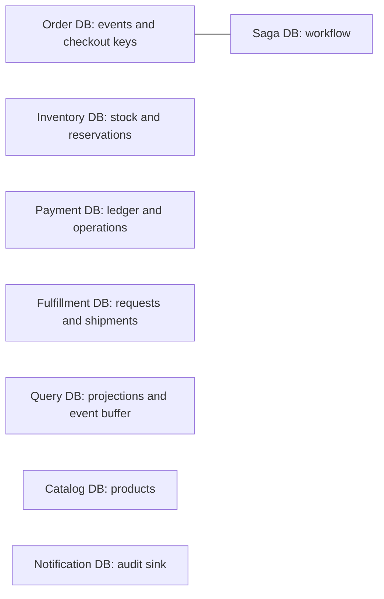

## Checkout request

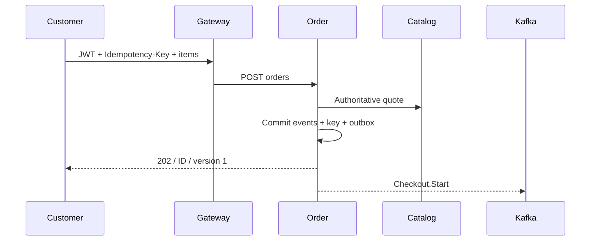

## Order Saga

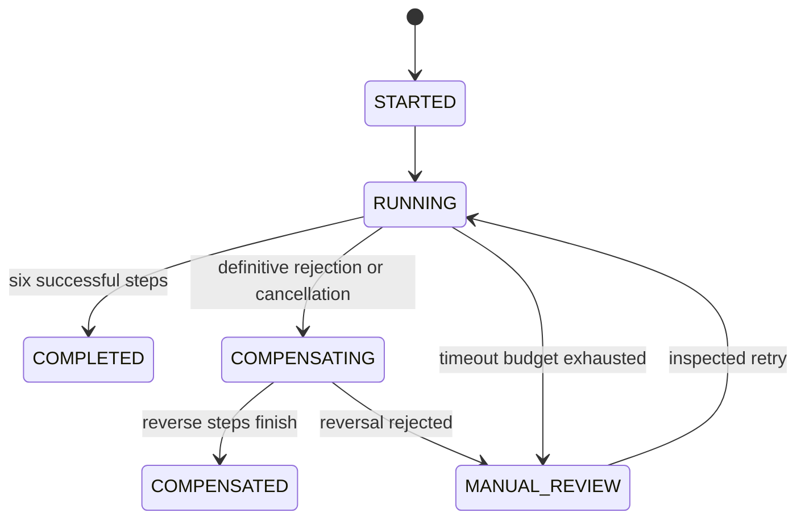

## Inventory TCC

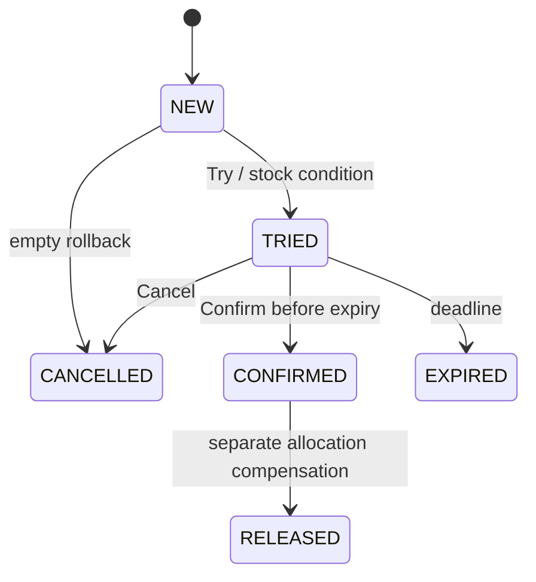

## Payment authorization

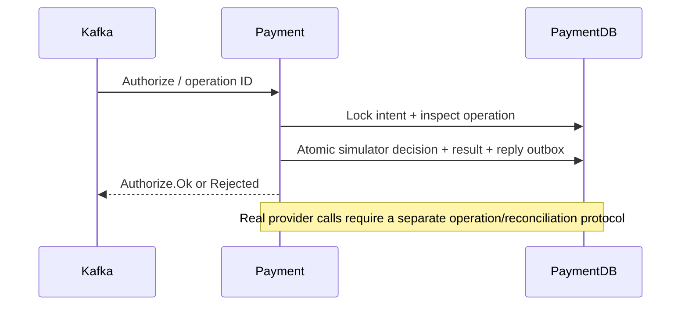

## Compensation

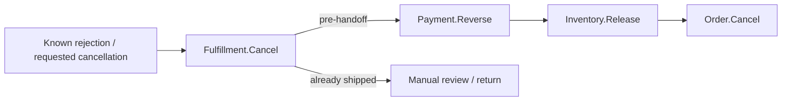

## Event Sourcing

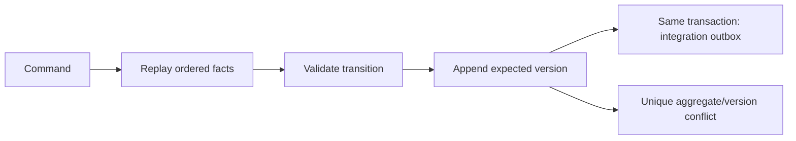

## CQRS projection

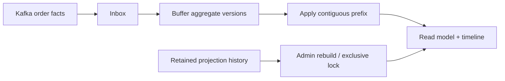

## Transactional Outbox

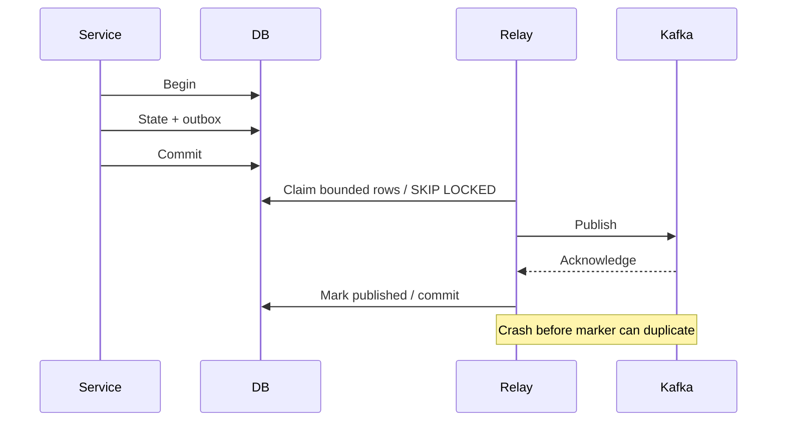

## Transactional Inbox

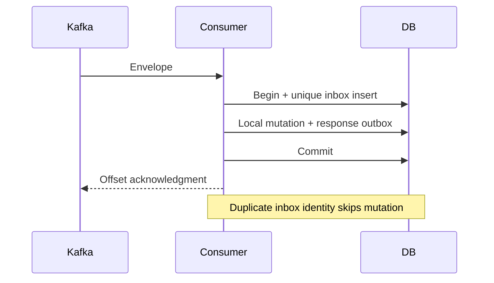

## Refund processing

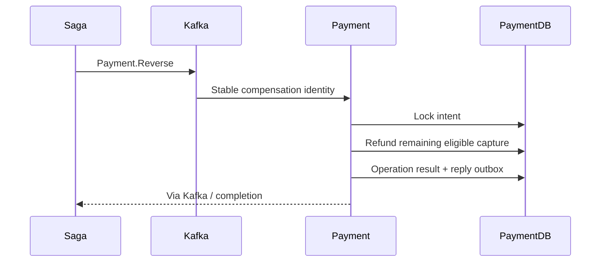

## Saga recovery

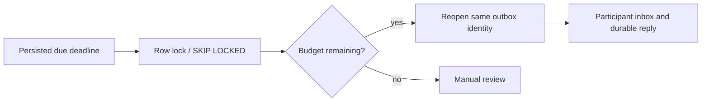

## Kubernetes deployment

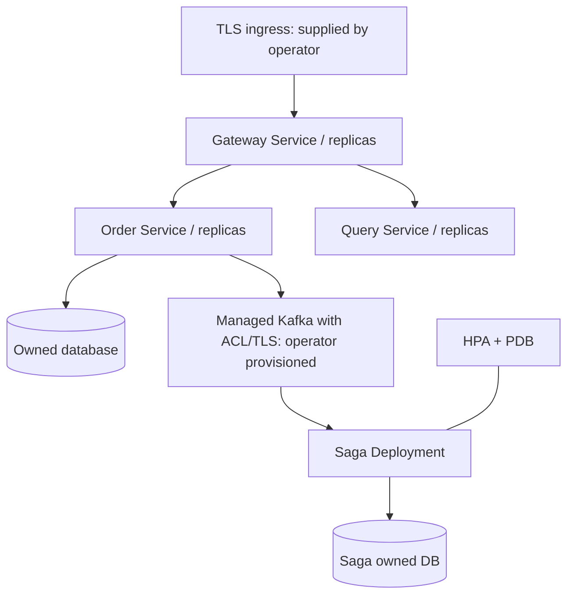

## Domain classes

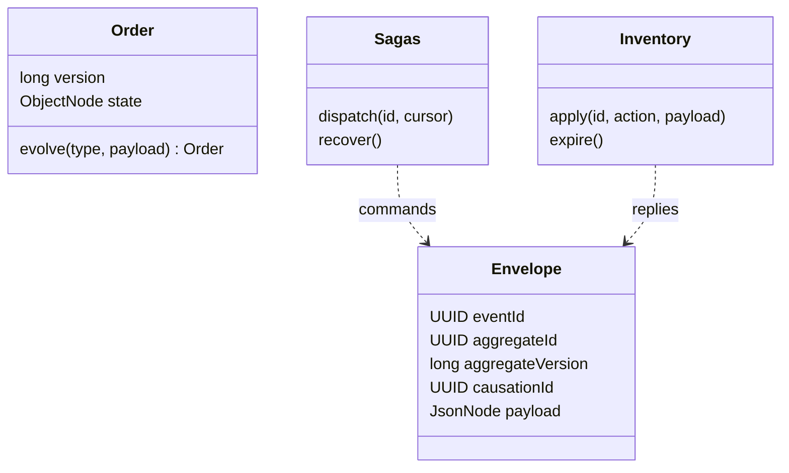

